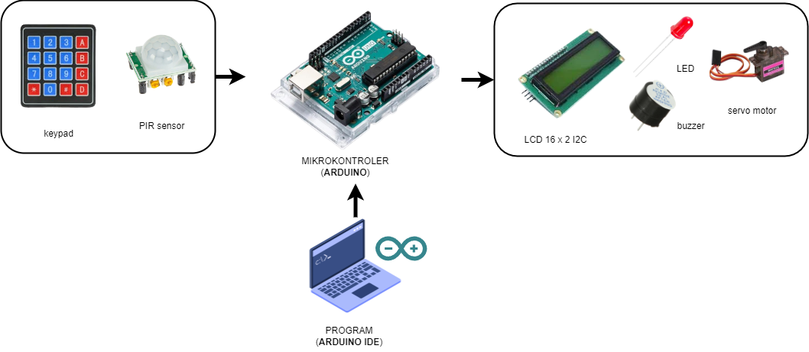
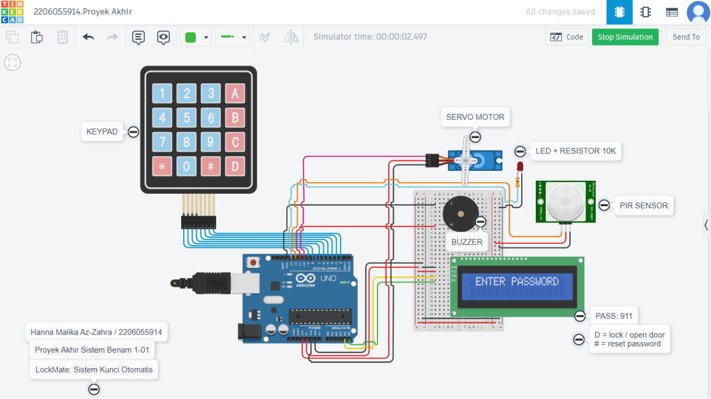
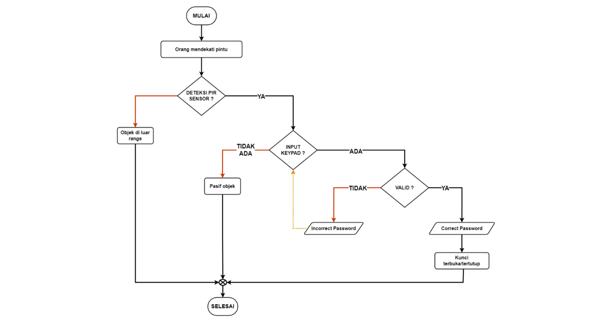

# LockMate: SISTEM KUNCI OTOMATIS

## ARSITEKTUR SISTEM

Masukan berasal dari keypad dan sensor PIR. Keduanya dibaca oleh Arduino melalui program yang telah diunggah, lalu program tersebut mengendalikan keluaran berupa LCD, LED, buzzer, dan motor servo.



| Komponen | Jumlah | Keterangan |
|---|---|---|
| Arduino Uno | 1 | Pengendali utama |
| Keypad 4x4 | 1 | Input PIN dan perintah |
| Sensor PIR | 1 | Mendeteksi gerakan di dekat pintu |
| LCD 16x2 I2C | 1 | Alamat I2C `0x27` |
| LED (merah) | 1 | Indikator deteksi PIR |
| Resistor 330 Ω | 1 | Pembatas arus LED |
| Buzzer | 1 | Penanda hasil input PIN |
| Motor servo | 1 | Penggerak mekanisme kunci |
| Breadboard + kabel jumper | - | Perakitan rangkaian |
| Baterai 9V | 1 | Catu daya rangkaian |

## INTERKONEKSI (PINOUT)

Rangkaian disuplai sumber tegangan eksternal **9V**. Power line pada breadboard diberi tegangan 5V dan GND dari Arduino, lalu VCC dan GND sensor PIR serta LCD dihubungkan ke power line tersebut.



| Komponen | Pin Komponen | Pin Arduino |
|---|---|---|
| Keypad 4x4 | Baris 1–4 (R1–R4) | D9, D8, D7, D6 |
| Keypad 4x4 | Kolom 1–4 (C1–C4) | D5, D4, D3, D2 |
| Sensor PIR | Sinyal (OUT) | D12 |
| Sensor PIR | VCC / GND | 5V / GND (via breadboard) |
| LCD I2C | SDA | A4 |
| LCD I2C | SCL | A5 |
| LCD I2C | VCC / GND | 5V / GND (via breadboard) |
| Buzzer | Terminal positif (+) | D11 |
| LED | Anoda (+), melalui resistor 330 Ω | D13 |
| Motor servo | Sinyal | D10 |

> Catatan: kaki katoda LED dan terminal negatif buzzer dihubungkan ke GND.

## CARA KERJA



Sistem memiliki dua jalur masukan digital yang bekerja secara bersamaan:

1. **Deteksi objek (sensor PIR)**
   Sensor PIR membaca keberadaan objek yang mendekati pintu. Ketika gerakan terdeteksi, **LED merah menyala**. LED padam kembali saat gerakan tidak lagi terdeteksi.

2. **Akses pintu (keypad)**
   Pengguna memasukkan PIN melalui keypad, dan setiap digit ditampilkan sebagai `*` di LCD. Hasil pemeriksaan PIN ditandai dengan **buzzer**:
   - **PIN benar**: buzzer berbunyi 1 kali (500 ms), servo bergerak, dan LCD menampilkan `CORRECT PASSWORD` beserta status pintu.
   - **PIN salah**: buzzer berbunyi 3 kali (pendek) dan LCD menampilkan `WRONG PASSWORD!`.

### Fungsi Tombol Keypad

| Tombol | Fungsi |
|---|---|
| `0`–`9`, `A`, `B`, `C`, `*` | Memasukkan karakter PIN |
| `D` | Mengunci atau membuka pintu (bergantian sesuai status saat ini), dengan memeriksa PIN terlebih dahulu |
| `#` | Mereset PIN yang sedang diketik dan membersihkan LCD |

### Cara Penggunaan

1. Nyalakan rangkaian. LCD menampilkan `HALO! SELAMAT DATANG`, lalu beralih ke `ENTER PASSWORD`. Pintu berada pada kondisi **terbuka**.
2. Ketik PIN bawaan: **`911`**.
3. Tekan **`D`** untuk mengunci pintu. Jika PIN benar, servo berputar ke 180°.
4. Untuk membuka kembali, ketik PIN lagi, lalu tekan **`D`**.
5. Jika salah ketik, tekan **`#`** untuk mengulang dari awal.

> Perhatian: jika jumlah digit yang diketik mencapai 6 (`maxPassLength`) tanpa menekan `D`, program akan langsung memeriksa PIN. Karena PIN bawaan hanya 3 digit, input 6 digit akan dianggap salah. Jika PIN diubah, sesuaikan juga `maxPassLength`.

### Format Log Serial

Setiap iterasi program mencetak satu baris dengan format:

```
waktu_ms, status_PIR, status_PIN
```

| Nilai `status_PIN` | Arti |
|---|---|
| `0` | Tidak ada pemeriksaan PIN |
| `1` | PIN benar |
| `2` | PIN salah |


Parameter berikut dapat diubah pada `automatic_lock.ino`:

| Parameter | Lokasi | Keterangan |
|---|---|---|
| PIN | `Password pass = Password("911");` | Ganti `"911"` dengan PIN yang diinginkan |
| Panjang PIN maksimum | `maxPassLength` | Default `6` |
| Alamat I2C LCD | `LiquidCrystal_I2C lcd(0x27, 16, 2);` | Ubah jika modul LCD memakai alamat lain (misalnya `0x3F`) |
| Sudut servo | `servo.write(90)` / `servo.write(180)` | Sesuaikan dengan mekanisme kunci |
| Pin perangkat | `#define ... _PIN` | Sesuaikan jika pengkabelan berbeda |
